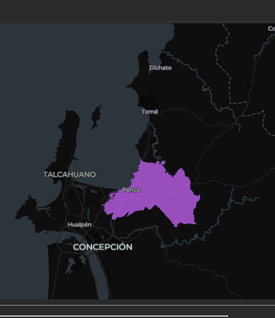

# FieldMaps | Límites administrativos reutilizables

[Repositorio en GitHub](https://github.com/Zelaznog-J/fieldmaps_boundaries){ .md-button .md-button--primary }
[Abrir en Colab](https://colab.research.google.com/github/Zelaznog-J/fieldmaps_boundaries/blob/main/FieldMaps_geoboundaries_reutilizable.ipynb){ .md-button }

## Resumen

Notebook reutilizable que consulta el Parquet público de FieldMaps (`adm4_polygons`) y permite elegir, de forma interactiva, un país, una región y opcionalmente una unidad ADM3. El resultado es un GeoJSON y un mapa interactivo, sin descargar el archivo completo ni editar las consultas SQL. Funciona en Google Colab y en Jupyter local.

| Aspecto | Detalle |
| --- | --- |
| Fuente | FieldMaps, `adm4_polygons.parquet` (179 893 registros, 318 valores de `adm0_src`) |
| Acceso | DuckDB con extensión `spatial`, leyendo el Parquet por HTTP |
| Selección | `input()` en cascada: `adm0_src`, `adm1_name` y, opcional, `adm2_name` + `adm3_name` |
| Salida | GeoJSON en EPSG:4326 y mapa interactivo con Lonboard |
| Herramientas | Python con DuckDB, Pandas, GeoPandas y Lonboard |

!!! success "Hallazgo principal"
    Un mismo flujo recorre cualquier territorio sin tocar el SQL: de `CHL` a la Región del Biobío y a la comuna de Penco, con 1 registro y 0 geometrías nulas o inválidas.

{ width="520" }

## Objetivos

1. Construir un procedimiento reutilizable, sin ningún país fijado en el código.
2. Listar los valores administrativos realmente disponibles antes de filtrar.
3. Permitir elegir por número o por texto, evitando errores de tildes y codificación.
4. Mantener consultas seguras con parámetros SQL (`?`) en vez de concatenar texto.
5. Entregar un subconjunto validado, un resumen por ADM2, un GeoJSON y una visualización.

## Flujo de trabajo

1. **Entorno.** Detecta Colab o local e instala solo las dependencias faltantes.
2. **Conexión.** DuckDB lee el Parquet remoto; la geometría sale como WKB con `ST_AsWKB`.
3. **Exploración.** Conteo de registros y esquema de columnas.
4. **Selección en cascada.** `adm0_src` (318 valores), `adm1_name` (16 regiones en Chile) y ADM3 opcional (33 unidades en Biobío); *Enter* conserva todo el ADM1.
5. **Extracción.** Consulta parametrizada con solo los campos necesarios.
6. **Control de calidad.** GeoDataFrame en EPSG:4326, con conteo de geometrías nulas e inválidas.
7. **Exportación.** GeoJSON a carpeta local o Google Drive, con nombre de archivo generado.
8. **Visualización.** Mapa interactivo con Lonboard.

## Decisiones técnicas

- **Consultas parametrizadas**, para admitir apóstrofes y caracteres especiales sin errores.
- **Elección por índice**, que evita copiar nombres largos o con codificación alterada.
- **ADM2 + ADM3 como par**, porque un mismo nombre ADM3 puede repetirse en distintos ADM2.
- **Geometría en WKB desde SQL**, para pasar a GeoPandas sin archivos intermedios.

## Limitaciones

- La fuente trae algunos nombres con la codificación alterada (por ejemplo `Región del Bío-Bío`); elegir por índice lo sortea, pero no corrige el dato de origen.
- El recurso contiene polígonos ADM4, así que filtrar por ADM3 puede devolver varias filas. Para un único límite hay que hacer un `dissolve`.
- El CRS EPSG:4326 se asume, no se verifica. Antes de medir áreas o distancias hay que confirmarlo y reproyectar.
- Los nombres y polígonos dependen de la versión de FieldMaps consultada; conviene revisar licencia y fecha antes de usarlos.
